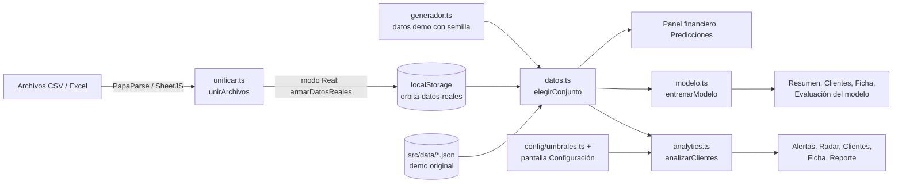

# Guía técnica de Órbita Pulse

Para explicar el código: **de dónde sale cada dato, cómo se calcula y por qué se hizo así**.
Las rutas son relativas a la raíz del repositorio; los números de línea son de referencia (pueden moverse un poco con cambios futuros).

---

## 1. Arquitectura en una frase

Es una **aplicación web de una sola página (SPA)** hecha con **React + TypeScript + Vite**. **No tiene servidor ni base de datos**: todos los cálculos, incluido el entrenamiento del modelo, ocurren **en el navegador** del usuario.

| Capa | Tecnología | Dónde |
|---|---|---|
| Interfaz | React 18, React Router 6, Tailwind CSS 3 | `src/pages/`, `src/components/` |
| Gráficas | Recharts 2 | dentro de cada página |
| Lectura de archivos | PapaParse (CSV) y SheetJS/xlsx (Excel) | `src/pages/CargarDatos.tsx` |
| Lógica de negocio | TypeScript puro (sin librerías) | `src/lib/analytics.ts`, `unificar.ts`, `reporte.ts` |
| Modelo predictivo | Regresión logística escrita a mano | `src/lib/modelo.ts` |
| Datos | JSON estáticos (demo) o `localStorage` (datos reales subidos) | `src/data/`, `src/lib/modo.ts` |
| Pruebas | Vitest (lógica) y Playwright (interfaz) | `tests/unidad/`, `tests/interfaz/` |

**¿Por qué sin servidor?** Era un requisito del reto (prototipo, sin login ni backend) y además es un argumento de privacidad: los datos no salen del computador de quien los carga.

---

## 2. Flujo de los datos



Paso a paso:

1. **¿Qué datos se usan?** `src/lib/datos.ts → elegirConjunto()` (línea ~56) decide según el modo (`src/lib/modo.ts`):
   - **Demo original** → los JSON de `src/data/` (clientes, productos, ventas, TRM, meta).
   - **Demo al azar** → `generarDatos(semilla)` de `src/lib/generador.ts`, en el navegador.
   - **Real** → lo guardado en `localStorage` (clave `orbita-datos-reales`) o, si no hay, `src/data/real/` (vacío → todo en cero).
2. **Cálculos que no dependen de los umbrales** se hacen **una vez al cargar** en `datos.ts`: pronóstico, serie mensual, TRM, ventas por categoría, correlación y **el modelo predictivo** (`export const modelo = entrenarModelo(...)`).
3. **Cálculos que sí dependen de los umbrales** (estados, alertas, backtest, valor en riesgo) están en `calcularDatos(u)` (`datos.ts`, línea ~120). El `UmbralesProvider` (`src/lib/umbrales.tsx`) lo recalcula con `useMemo` cada vez que se mueve un control en **Configuración**, y las pantallas lo leen con el hook `useDatos()`.
4. Las **pantallas** solo leen y dibujan: no hacen cálculos de negocio propios (salvo agrupar o filtrar para mostrar).

**Cambiar de modo recarga la página** (`cambiarModo`, `modo.ts`): los datos se leen una vez al iniciar; recargar fue más simple que volver reactivos todos los módulos.

---

## 3. Estructura del proyecto

```
src/
  config/      umbrales.ts (1,2× / 2× / 180 días) · impacto.ts (horas antes vs. ahora)
  data/        JSON de la demo original · real/ (vacío, para datos reales fijos)
  lib/
    datos.ts        punto único de acceso a los datos y al modelo
    modo.ts         modo Demo/Real, semilla de la demo al azar, datos reales en localStorage
    generador.ts    generador de datos sintéticos con semilla (mulberry32)
    unificar.ts     lectura y unión de archivos: columnas, fechas, números, duplicados
    datosReales.ts  convierte el resultado de la unión en el conjunto del modo Real
    analytics.ts    RFM, ciclo, estados, puntaje, recomendaciones, alertas, pronóstico, backtest
    modelo.ts       regresión logística: variables, entrenamiento, predicción y métricas
    reporte.ts      reporte del mes
    mensaje.ts      mensaje sugerido para el cliente
    umbrales.tsx · idioma.tsx · tema.tsx · contactados.tsx · presentacion.tsx   (estado global con React Context)
    format.ts · catalogo.ts · descargar.ts · preferencias.ts · types.ts
  components/  Layout, gráficas compartidas, explicaciones y componentes base (ui/)
  pages/       una pantalla por archivo
scripts/       generate-data.ts (escribe la demo) · capturas.ts (imágenes para las diapositivas)
tests/         unidad/ (Vitest) · interfaz/ (Playwright)
```

**Tipos de datos** (`src/lib/types.ts`): `Cliente`, `Producto`, `Venta` (una línea por producto y fecha, con `valor_usd` y `valor_cop`) y `Trm` (fecha y valor).

---

## 4. ¿De dónde sale cada número de la pantalla?

| Pantalla | Dato | Cálculo | Archivo |
|---|---|---|---|
| Resumen general | Clientes / Ventas confirmadas | `clientes.length` / `ventas.length` | `pages/Inicio.tsx` |
| Resumen general | Ingresos COP | suma de `valor_cop` de todas las ventas | `pages/Inicio.tsx` |
| Resumen general | Ingresos mensuales (COP) | `ventasPorMes(ventas)`, sin el mes en curso | `lib/analytics.ts:510` |
| Resumen general | Clientes por situación | conteo por `estado` | `datos.ts → calcularDatos` |
| Resumen general | Clientes prioritarios | probabilidad del modelo, entre quienes llevan ≥ 15 días sin comprar, top 6 | `pages/Inicio.tsx` + `lib/modelo.ts` |
| Resumen general | Ventas en riesgo (US$/año) | `valorEnRiesgo()` | `lib/analytics.ts:404` |
| Resumen / Evaluación | Precisión, exhaustividad, F1 | `metricas()` sobre la validación | `lib/modelo.ts:214` |
| Clientes / Ficha | Ciclo, días sin comprar, total | `analizarClientes()` | `lib/analytics.ts:287` |
| Clientes / Ficha | Riesgo 0–100 | `puntajeDesdeRatio()` (+5 si la TRM subió) | `lib/analytics.ts:72` |
| Clientes / Ficha | Prob. compra (30 días), prioridad | `entrenarModelo()` → `predicciones` | `lib/modelo.ts:246` |
| Ficha | «¿Por qué está en riesgo?» y confianza | `ExplicacionRiesgo`, `nivelConfianza()` | `components/ExplicacionRiesgo.tsx` |
| Ficha / Alertas | Producto a ofrecer y su valor | `recomendarProducto()` | `lib/analytics.ts:198` |
| Alertas | Orden de prioridad | `generarAlertas()` | `lib/analytics.ts:432` |
| Panel financiero | TRM hoy y variación a 30 días | `variacionTrm30()` | `lib/analytics.ts:58` |
| Panel financiero | Ventas vs. TRM y correlación | `ventasContraTrm()`, `correlacion()` (Pearson) | `lib/analytics.ts:692, 710` |
| Predicciones | Pronóstico del mes | `pronosticarVentas()` | `lib/analytics.ts:536` |
| Predicciones | % de acierto (7 de 8) | `backtest()` | `lib/analytics.ts:622` |
| Centro de datos | Filas, duplicados, problemas | `unirArchivos()` | `lib/unificar.ts:165` |
| Reporte del mes | Ventas, cambios de estado, top clientes | `generarReporte()` | `lib/reporte.ts:44` |

---

## 5. Fórmulas clave (exactas)

### 5.1 Indicadores por cliente — `analizarClientes()` (`analytics.ts:287`)

- **Recencia (R)** = días entre la última compra y «hoy» (la fecha de corte de los datos).
- **Frecuencia (F)** = número de **días distintos** con compra.
- **Monto (M)** = suma de `valor_usd`.
- **Ciclo** = (última compra − primera compra) ÷ (compras − 1), en días (`cicloPromedio`, línea 382).
  - Con **menos de 3 compras** se usa la **mediana** de los ciclos de todos los clientes (`cicloEstimado = true`).
  - Nunca menos de **7 días** (evita ciclos absurdos de 1 día).
- **Próxima compra** = última compra + ciclo.
- **Ratio de atraso** = recencia ÷ ciclo.

### 5.2 Estado y puntaje

```ts
// analytics.ts:78
if (ratio > u.inactivo || recencia > u.diasMaximosSinComprar) return 'frio'; // Inactivo
if (ratio > u.riesgo) return 'riesgo';
return 'activo';
```
Umbrales por defecto en `src/config/umbrales.ts`: `riesgo 1,2`, `inactivo 2,0`, `diasMaximosSinComprar 180`.

**Puntaje de riesgo 0–100** (`puntajeDesdeRatio`, línea 72), por tramos lineales:
- ratio 0 → 1: de 0 a 30
- ratio 1 → umbral inactivo: de 30 a 80
- más allá: 80 + 10 por cada punto de ratio, con tope en 100
- **+5** si la TRM subió más de 5 % en 30 días y el ratio es mayor que 0,8 (compras en dólares tienden a aplazarse).

### 5.3 Valor del cliente y ventas en riesgo

```ts
// analytics.ts:398 — compra anual promedio
meses = max(3, (hoy − primera compra) / 30,44 días)
valorAnual = montoUsd / meses × 12
```
- **Ventas en riesgo** = suma de `valorAnual` de los clientes **en riesgo**.
- **Inactivos recuperables** = suma de `valorAnual` de los **inactivos con ≤ 365 días** sin comprar.

### 5.4 Prioridad de las alertas — `generarAlertas()` (línea 432)

```ts
peso = 0,6 + 0,4 × √(montoUsd / montoMáximo)   // los clientes grandes pesan más
riesgo:     prioridad = puntaje × peso
inactivo:   prioridad = puntaje × peso × 0,75    // solo si lleva ≤ 365 días
recompra:   prioridad = 30 × peso                // activos cuya próxima compra cae en ≤ 7 días
```

### 5.5 Recomendación de producto — `elegirProducto()` / `recomendarProducto()` (líneas 104 y 198)

Tres reglas, en orden:
1. **Renovación**: servicio recurrente comprado **≥ 2 veces**, cuyo atraso (días desde la última compra ÷ su intervalo) está **entre 1 y 3**. Si hay varios, el de menor atraso.
2. **Venta cruzada**: «clientes del mismo sector que compraron X también compraron Y», y Y aparece en al menos 2 clientes.
3. **Lo más vendido en su sector** que el cliente aún no tiene.

**Valor estimado**: en una renovación, lo que **ese cliente** paga en promedio por compra de ese producto (por eso el Cliente 23 da **US$ 4.800**). En los demás casos, el promedio general por compra.

### 5.6 Pronóstico y backtest

- **Pronóstico del mes** (`pronosticarVentas`, línea 536) = promedio de los **3 últimos meses cerrados** + tendencia, donde tendencia = (mes −1 − mes −3) ÷ 2. Nunca negativo.
- **Backtest** (línea 622): se corta la historia **60 días atrás**, se analizan los clientes con lo que se sabía ese día y se marcan los no activos (sin contar los de más de 180 días). Acierto = marcados que **no** compraron en esos 60 días. Demo: **7 de 8**.

---

## 6. El modelo predictivo — `src/lib/modelo.ts`

**Pregunta que responde:** ¿este cliente comprará en los **próximos 30 días**? (clasificación binaria con probabilidad).

### 6.1 Variables (`variablesEn`, línea 125)

Calculadas en una fecha `t` usando **solo compras hasta `t`**, sin mirar el futuro:

| # | Variable | Transformación |
|---|---|---|
| 1 | Atraso frente a su ritmo | `min(recencia / ciclo, 6)` |
| 2 | Número de compras | `log(1 + n)` |
| 3 | Total comprado | `log(1 + USD / 1000)` |
| 4 | Compras en los últimos 90 días | conteo |
| 5 | Ciclo corto | `max(0, 1 − ciclo / 90)` |
| 6 | Base instalada | 0 o 1 |
| 7 | Compra servicios recurrentes | 0 o 1 |

Se quitó «días sin comprar» porque repetía la información del atraso (colinealidad) y confundía los pesos (decisión 69).

### 6.2 Datos de entrenamiento (`filasEntrenamiento`, línea 155)

- **12 «fotos»**, una cada **15 días** hacia atrás.
- La foto más reciente queda **30 días antes** del límite, para que su resultado (si compró o no en los 30 días siguientes) ya se conozca.
- Cada fila es cliente × foto: unas **720 filas** en la demo (60 clientes × 12 fotos).

### 6.3 Entrenamiento (`entrenarLogistica`, línea 184)

- Variables **estandarizadas** (media 0, desviación 1).
- **Descenso de gradiente** por lotes: 600 iteraciones, tasa 0,3 y regularización L2 de 0,01.
- `p = 1 / (1 + e^-(b + Σ wᵢ·xᵢ))`.
- **Determinista**: pesos iniciales en 0 y sin aleatoriedad, así que los mismos datos dan siempre el mismo modelo. Corre en ~100 ms.
- Requisito mínimo: **40 filas**, con al menos **5 de cada clase**. Si no se cumple, no se entrena y lo explica (modo Real vacío).

### 6.4 Validación (`entrenarModelo`, línea 246)

1. Se entrena un modelo **solo con fotos anteriores a hoy − 30 días**.
2. Ese modelo predice en la fecha **hoy − 30** (umbral 0,5) y se compara con lo que pasó entre hoy − 30 y hoy.
3. Se compara con la **regla base**: «comprará si compró en los 30 días anteriores».
4. Se calculan precisión, exhaustividad, F1 y exactitud (`metricas`, línea 214) y la matriz de confusión.
5. Para las **predicciones de hoy** se vuelve a entrenar con todo lo disponible.

**Prioridad**: Alta si p ≥ 0,6; Media si p ≥ 0,35; Baja en el resto (`prioridadDesde`, línea 36) [umbrales por confirmar con la empresa].

**Explicación por cliente**: `aportes` = variable estandarizada × su peso. La ficha muestra las 3 de mayor valor absoluto.

### 6.5 Resultados con la demo (datos inventados)

| | Precisión | Exhaustividad | F1 |
|---|---|---|---|
| Modelo (ventana de los últimos 30 días) | 53,8 % | 91,3 % | 67,7 % |
| Regla base | 63,0 % | 73,9 % | 68,0 % |

En esa ventana el F1 empata. Validado en **6 ventanas mensuales**, el modelo promedia **F1 83 contra 76** de la regla. La pantalla hoy muestra solo la ventana más reciente (mejora pendiente: validación en varias ventanas).

---

## 7. Unión de archivos — `src/lib/unificar.ts`

1. **Columnas** (`reconocerColumnas`, línea 52): normaliza el texto (sin tildes, minúsculas, sin `._-`) y lo compara con una lista de **sinónimos** (`fecha/date/fecha de venta…`, `sku/referencia…`, `valor cop/total cop…`). Lee las columnas de **todas** las filas, no solo de la primera.
2. **Fechas** (`leerFecha`, línea 66): `aaaa-mm-dd` (con o sin hora), `dd/mm/aaaa`, `3-oct-2026` y número de serie de Excel.
3. **Números** (`leerNumero`, línea 86): el último separador es el decimal si le siguen 1 o 2 dígitos (`1.234,56`, `1,234.56`, `$ 4.500.000`).
4. **Clientes**: por código, por nombre o por número (`CLI-23`, `Cliente 023`, `customer 7` → `CLI-023`).
5. **Valor en USD**: directo, o pesos ÷ TRM (la de la fila o la del día).
6. **Duplicados**: misma fecha, cliente, producto y cantidad, y valor dentro de **±1 %** (el valor en pesos convertido puede variar centavos).
7. **Modo Real** (`crearNuevos: true`): los clientes y productos desconocidos se **crean** en vez de marcarse como problema. Luego `armarDatosReales()` (`datosReales.ts`) arma el conjunto: «hoy» = la fecha de la última venta y una TRM diaria rellenada con el último valor conocido. Sin TRM, los pesos quedan en 0 (no se inventa).

---

## 8. Datos de la demo — `src/lib/generador.ts`

- Generador pseudoaleatorio **mulberry32** con semilla. La **2026** es la demo original, y `npm run generate-data` vuelve a escribir exactamente los mismos JSON (hay una prueba que lo verifica).
- 60 clientes con perfiles: 25 frecuentes, 15 que se frenan, 10 fríos y 10 ocasionales. 20 productos en 6 categorías y 18 meses de historia.
- TRM: paseo aleatorio con reversión a la media, más una subida forzada en los últimos 35 días.
- **Cliente 23**: patrón fijo (suscripción de nube cada ~30 días, 50 días sin comprar) para que la historia de la demo funcione con cualquier semilla.

---

## 9. Estado de la aplicación

| Qué | Dónde se guarda | Clave |
|---|---|---|
| Idioma | `localStorage` | `orbita-idioma` |
| Tema | `localStorage` | `orbita-tema` |
| Modo Demo/Real | `localStorage` (o `?modo=` en la URL) | `orbita-modo` |
| Semilla de la demo al azar | `localStorage` | `orbita-semilla` |
| Datos reales subidos | `localStorage` | `orbita-datos-reales` |
| Clientes contactados | memoria (React Context) | — |
| Umbrales movidos en Configuración | memoria (se pierden al recargar) | — |

Proveedores de contexto (`src/main.tsx`): `IdiomaProvider > TemaProvider > BrowserRouter > UmbralesProvider > ContactadosProvider > PresentacionProvider`.

---

## 10. Pruebas

- `npm test` → **43 pruebas unitarias** (`tests/unidad/`): fechas, números, columnas, unión y duplicados, modo Real, estados, umbrales, backtest 7/8, Cliente 23, modelo (métricas, determinismo, validación, datos vacíos) y generador.
- `npm run test:e2e` → **44 pruebas de interfaz** (`tests/interfaz/`): todas las pantallas sin errores ni `NaN`, idioma, tema, menú, evaluación del modelo, orden por probabilidad, Centro de datos, modo Real (subir, usar y borrar), demo al azar, demo en vivo y celular (sin desplazamiento horizontal).

---

## 11. Preguntas técnicas probables

**¿Por qué una regresión logística y no algo más potente (random forest, XGBoost, redes)?**
Con pocos clientes (60 en la demo) un modelo complejo se sobreajusta. La logística es interpretable: se puede mostrar qué pesa más y explicar cada predicción. Además corre en el navegador sin servidor. Con datos reales y más volumen se puede comparar contra otros modelos usando la misma validación.

**¿Cómo evitan que el modelo «haga trampa» viendo el futuro?**
Cada variable se calcula solo con compras hasta la fecha de la foto, y el modelo de validación se entrena solo con fotos cuyo resultado se conocía antes de la fecha de prueba (sección 6.4). Hay pruebas que lo verifican.

**¿Qué pasa con muchos datos?**
Todo es lineal en el número de ventas. El entrenamiento tarda ~100 ms con 965 ventas. El límite práctico es `localStorage`: unos 5 MB, es decir decenas de miles de ventas. Para más volumen se necesitaría un servidor [por confirmar el volumen real con Green Services].

**¿Dónde se guardan los datos reales?**
Solo en el navegador de quien los sube (`localStorage`). No se envían a internet ni a GitHub, y el botón «Borrar datos reales» los elimina.

**¿Qué falta para producción?**
- Conexión directa a sus sistemas (ERP, facturación) en vez de subir archivos.
- Servidor con usuarios y permisos.
- Validación con datos reales y en varias ventanas.
- Umbrales acordados con la empresa.
- Programar el reentrenamiento.

Todo esto está **[por confirmar con Green Services]**.

**¿Qué límites tiene hoy?**
- Solo se ha probado con datos inventados.
- La validación de la pantalla usa una sola ventana de 30 días.
- La probabilidad no está calibrada: es un puntaje para ordenar, no un porcentaje exacto.
- No usa fechas de contrato o renovación, porque los datos de la demo no las tienen.
